# How Site Attendance works

This document walks through the whole system from start to finish: who uses it, what happens when a worker clocks in, how a week of hours becomes an approved and priced timesheet, and which rules the code and the database enforce along the way. The settings behind these rules are recorded in [DECISIONS.md](DECISIONS.md), and the time and money policy in [ROUNDING.md](ROUNDING.md).

## 1. What it is

Site Attendance is one responsive web app. Workers install it on their phones as a PWA, and managers use it on a tablet or desktop. It works online only: nothing is recorded unless the server has confirmed the save.

| Layer | Technology |
|---|---|
| UI and server | Next.js 15 (App Router), React 19, Tailwind 4 |
| Business rules | TypeScript services in `src/server/services/` |
| Database | PostgreSQL 16 through Drizzle ORM, with migrations in `src/server/db/migrations/` |
| Money and time | `decimal.js` (half-up rounding), `date-fns` and `@date-fns/tz` (Europe/Dublin) |
| Auth | Username plus 6-digit PIN hashed with argon2, session cookie |
| Tests | Vitest (unit and integration), Playwright (acceptance T01–T08 and responsive) |

Every request follows the same path:

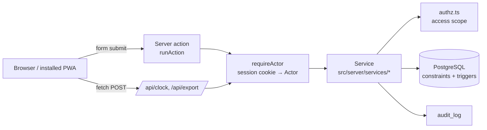

1. The browser submits a form, which runs a **server action**, or calls a JSON **API route**.
2. `runAction` (`src/server/action.ts`) gets the logged-in **Actor** with `requireActor()`. It turns expected `AppError`s into a message on screen, records unexpected errors in the error log for IT, and refreshes the page.
3. The **service** checks access through `src/server/authz.ts`, does its work inside a database transaction, and writes an audit row.
4. **PostgreSQL** is the last line of defence. Its constraints and triggers reject anything the services might miss, such as overlapping shifts or edits to approved weeks.

## 2. Code map

| Folder | What lives there |
|---|---|
| `src/app/(auth)/` | Login and change-PIN screens and their actions |
| `src/app/(app)/clock`, `timesheets`, `history` | Worker screens |
| `src/app/(app)/team/…` | Manager queue, timesheet review, team overview |
| `src/app/(app)/admin/…` | Users, projects, roles, rates, settings, IT support, audit log, export history |
| `src/app/(app)/costs` | CostMaster report |
| `src/app/(app)/system` | IT health and error log |
| `src/app/api/` | `clock` (clock in and out), `export` (CSV), `health` (monitoring probe) |
| `src/server/authz.ts` | **The only place access scope is computed** |
| `src/server/services/` | Business rules: `clock`, `timesheets`, `corrections`, `rates`, `exports`, `costmaster`, `admin`, `auth`, `audit`, `views` |
| `src/server/db/schema.ts` | Tables, checks and indexes |
| `src/server/db/migrations/0001_constraints.sql` | Database rules Drizzle can't express (exclusion constraint, lock triggers, append-only logs) |
| `src/lib/time.ts`, `src/lib/money.ts` | Week boundaries, DST-safe durations, rounding |
| `src/lib/i18n/en.ts` | All UI text, ready for translation |
| `public/sw.js`, `public/manifest.webmanifest` | PWA service worker and manifest |

## 3. Roles and who sees what

One login (`users`) can belong to a company as a **member** (`company_members`). Each member has role flags:

| Role | What they do | Home screen |
|---|---|---|
| **Worker** | Clock in and out, view their weeks, submit timesheets, comment | `/clock` |
| **Manager / supervisor** | Add workers to their crew and set their roles, enter crew hours, and review, correct, return and approve the timesheets of *assigned* workers | `/team` |
| **Admin** | Setup: users, projects, roles, rates, assignments, settings, grants. Can manage every worker in the company | `/admin` |
| **IT** | System health and error log only. Can't be combined with admin or manager | `/system` |
| **CostMaster** | Not a flag. It's a separate grant for all projects or named ones, optionally with export. Read-only | `/costs` |

`homePath()` in `src/server/auth/session.ts` decides where someone lands after login. A person can have several roles. For example, a foreman can be both a worker and a manager.

**Access scope is computed in one place.** Every screen, CSV export and direct link goes through `src/server/authz.ts`:

- `managedWorkerIds` / `canManageWorker`: an admin manages the whole company. A manager manages only the workers listed for them in `manager_assignments` (primary or cover). Removing an assignment removes access immediately.
- `canReadWorker`: you can always read your own records. Managers can read the workers they manage. IT can read records only with an active support grant.
- `hasSupportAccess`: IT gets read-only access to business data only while an admin-issued `support_grants` row is unexpired (1–168 h) and not revoked.
- `costScope` / `costProjectIds`: CostMaster sees only projects named in a `costmaster_grants` row (`project_id` NULL means all projects). Being a manager never grants CostMaster, and CostMaster never grants approval.
- `canExportTeam`: managers can download a CSV only if admin has switched on *manager export* in Settings.

**Nobody approves their own hours.** `approvalBlockers` in `timesheets.ts` refuses when the reviewer is the worker. The database also stops a manager being assigned to themselves (the `manager_not_self` check).

## 4. Login and sessions

Code: `src/server/services/auth.ts`, `src/server/auth/pin.ts`, `src/server/auth/session.ts`

1. The user enters a username and a 6-digit PIN. The PIN is checked against an **argon2** hash.
2. After **5 failed attempts** the account locks for **15 minutes**. Recovery is an admin PIN reset; there is no email or SMS.
3. On success, a random token goes into an `httpOnly` cookie called `sid`. The database keeps only its **sha256 hash** (`sessions.id`), so a database leak doesn't expose usable sessions.
4. When admin sets a temporary PIN, `mustChangePin` is true. `requireActor()` then redirects every page to `/change-pin` until the user picks their own PIN.
5. **Logging in never clocks in, and logging out never clocks out.** An open shift stays open across sessions.

## 5. Clocking in and out, step by step

Code: `src/app/(app)/clock/clock-panel.tsx` → `src/app/api/clock/route.ts` → `src/server/services/clock.ts`

### Clock in

1. The worker picks a **project** and a **role**. The lists come from `clockOptions()` and contain only *assigned and active* projects and roles.
2. The phone creates a new **UUID idempotency key** for this button press and sends `POST /api/clock {action:"in", key, projectId, jobRoleId}`.
3. `clockIn()`:
   - looks up the key first. If an entry with this key already exists, it's a retry, so the original entry is returned (`replayed: true`) and no duplicate is created;
   - re-checks that the project and role are assigned to the worker and active;
   - takes the time from the **database clock** (`select now()`), never from the phone;
   - finds or creates the worker's **draft timesheet** for that Dublin week (`ensureTimesheet`);
   - inserts a `work_entries` row with `status = 'open'` and writes an audit row.
4. The server replies `200` only **after the transaction commits**.

### Clock out

1. A new key is created and sent with `POST /api/clock {action:"out", key}`.
2. `clockOut()` locks the worker's open entry (`SELECT … FOR UPDATE`), takes `now()` from the database, and calls `closeEntryAt()`.
3. `closeEntryAt()` uses `splitAtWeekBoundaries()` to cut the shift at every **Monday 00:00 Europe/Dublin**:
   - the first piece updates the original entry;
   - each later piece becomes a new entry in the next week's timesheet, linked by a shared `splitGroupId` and recorded in `entry_revisions` as `split`;
   - no time is duplicated or lost.
4. Each piece is **priced** right away (see section 7).

### What the worker sees when the network fails

The clock panel has explicit states: *saving*, *saved*, *error* and **uncertain**. If the request fails or no clear answer comes back, the panel shows *uncertain* and **keeps the same key**. Pressing *Retry* resends the identical request, so the server either saves it once or returns what it already saved. A retry can never double-clock.

### Safety nets in the database

| Rule | How it's enforced |
|---|---|
| At most one open shift per worker | Partial unique index `work_entries_one_open_per_worker` |
| No overlapping time for a worker | Gist exclusion constraint `work_entries_no_overlap`, where open entries count as running to infinity |
| End after start, open has no end, closed has an end | Check constraints on `work_entries` |
| Retried keys can't create a second row | Unique `clock_in_key` / `clock_out_key` |

`handleClockConflict()` turns the database errors into plain messages: `23505` means "already clocked in" (or a concurrent replay of the same key), `23P01` means "overlaps another entry", and `timesheet_locked` means "this week is approved".

## 6. Time and money rules

The full policy is in [ROUNDING.md](ROUNDING.md). In short:

- Times are stored in **UTC** and displayed and grouped by week in **Europe/Dublin** (`src/lib/time.ts`).
- A week runs **Monday 00:00 to Sunday 24:00** Dublin time.
- Duration is **exact elapsed seconds** (`elapsedSeconds`), so midnight and DST changes are handled correctly. A 00:00–06:00 shift lasts 5 h on the spring change day and 7 h on the autumn one.
- **Entry value = seconds ÷ 3600 × hourly rate, rounded half-up to the cent, per entry** (`entryValue` in `src/lib/money.ts`).
- **Totals are sums of the rounded entry values** (`sumMoney`), so screens, CostMaster and CSV always agree.
- Hours are displayed to 2 decimals. Nothing is rounded to 15-minute steps, and breaks are never deducted automatically: for a break, the worker clocks out and back in.

Example: 20 h × €28 + 15 h × €30 + 5 h × €25 = **€1,135.00** for **40.00 h**.

## 7. Rates

Code: `src/server/services/rates.ts`

Admin enters agreed rates (EUR) **per hour or per day**, with an *effective from* date and an optional *effective to* date. A rate always belongs to a role, and can also be tied to a worker, a project, or both.

When an entry is priced, `resolveRate()` collects every rate that applies to its worker, project and role on the entry's Dublin start date. `pickRate()` then chooses one:

1. The **most specific level** wins: worker+project (4) > worker (3) > project (2) > role standard (1).
2. Within that level, the **latest effective-from** wins.
3. If two rates are tied at the same level and date, the result is a **conflict**.
4. If no rate applies, the result is **missing**.

`priceEntry()` stores `rateId`, `appliedRate`, `rateUnit` (`hour` / `day`), `value` and `rateStatus` (`ok` / `missing` / `conflict`) on the entry. An hourly value is paid seconds × rate. A day-rate value is the day amount (`rateValue` in `src/lib/money.ts`). Two day-rate entries on the same day block approval (`day_rate_twice`), so a day is never paid twice. A missing or conflicting rate never stops a worker recording time, but it **blocks approval** until admin fixes it.

When admin adds or ends a rate, `repriceUnapproved()` re-prices closed entries in timesheets that are **not approved**. Approved values are never rewritten.

## 8. The weekly timesheet lifecycle

Code: `src/server/services/timesheets.ts`

There is one `timesheets` row per worker per week. Its status moves like this:

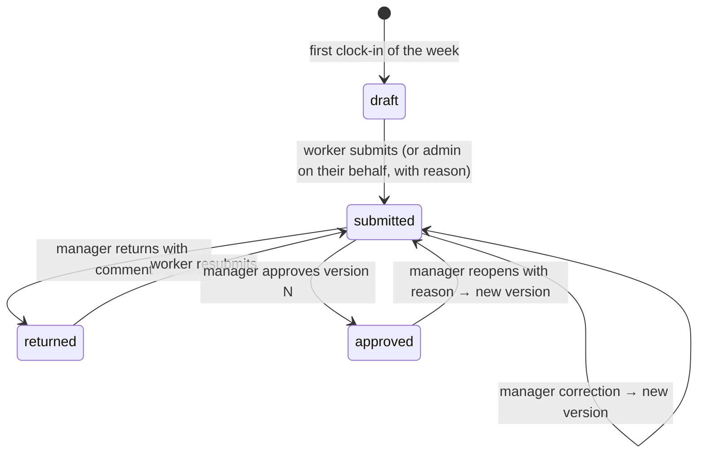

### Versions and snapshots

Every submission, resubmission, admin submission, manager correction, reopen or rate change creates a **timesheet version** (`createVersion`). A version holds a frozen JSON **snapshot** of every non-void entry (times, seconds, rate, value, status) plus the totals (`buildSnapshot`). Managers always review and approve a **specific version number**.

### Submit

`submitTimesheet()` checks that the timesheet belongs to the worker and is draft or returned. It also checks that **the week has ended** (`weekEndInstant`), so no more entries can land in it, and that no shift is still open. It then refreshes pricing, freezes a new version and sets the status to `submitted`.

Overdue drafts (the week has ended but the timesheet wasn't submitted) appear in the manager's queue. An admin, or the worker's own supervisor, can submit one on the worker's behalf with a reason (`submitOnBehalf`).

### Return

`returnTimesheet()` requires a comment. The worker sees it, fixes things up through comments and correction requests, and resubmits.

### Approve

`approveTimesheet(timesheetId, versionNo)`:

1. Locks the timesheet and checks that the actor manages the worker.
2. Runs `approvalBlockers()`. Any of these stops approval:
   - the reviewer is the worker (**self-approval**);
   - the status isn't `submitted`;
   - an entry is still **open**;
   - an entry has a **missing** or **conflicting** rate.
3. Refuses if a newer version exists ("the timesheet changed").
4. **Compares the version's snapshot with the live data.** If anything differs (for example, admin changed a rate after submission), it creates a new `rates_changed` version and **does not approve**. The manager reviews the new figures and approves again.
5. Otherwise it stamps the version `approvedAt` / `approvedBy` and sets the timesheet to `approved` with `approvedVersion = N`.

### Reopen

`reopenTimesheet()` requires a reason. It moves an approved timesheet back to `submitted` and creates a new version. **The earlier approved version stays unchanged** for traceability.

## 9. Manager corrections

Code: `src/server/services/corrections.ts`

Workers never edit entries. They add comments or **correction requests** (`addWorkerComment`). Managers and admins correct entries for the workers they manage:

| Action | Function | Notes |
|---|---|---|
| Change project, role or times, or add a missing clock-out | `correctEntry` | Recorded as `corrected`, or `reconstructed` when it closes an open entry |
| Add a missing entry | `addEntry` | `source = 'manager'` |
| Remove a duplicate or mistake | `voidEntry` | The entry is kept but excluded from totals |

Every correction:

- **requires a reason** (also checked in the database: `revision_reason_required`);
- is refused if the week is approved; reopen it first;
- can't put a start or end time in the future, and **can't span two weeks** (enter two entries instead);
- re-prices the entry;
- writes an `entry_revisions` row with the **before** and **after** values, so the worker can see the original, the new value and the reason;
- creates a new timesheet version if the timesheet was already submitted (`versionAfterCorrection`), so the manager approves what was actually changed.

The manager queue (`managerQueue` in `views.ts`) groups timesheets into *submitted*, *issues*, *overdue* and *returned*. It also flags entries for attention (`entryFlags`): *Missing clock out* (an entry still open from an earlier week, or open longer than the long-shift threshold), *Over N h* (a closed shift longer than the threshold, 14 h by default), and *No rate* / *Rate conflict*. Hours are never cut automatically.

### Supervisor crew and crew hours

Code: `src/server/services/crew.ts`, screens `/team/crew` and `/team/hours`

Supervisors (managers) can run their crew without every worker using the app:

1. **My crew** (`/team/crew`). The supervisor adds a worker with first, middle and last name, contact details, engagement type, their roles and their projects (`addCrewWorker`). The worker ID is generated automatically (W001, W002…) unless one is typed in. The supervisor can also enter the worker's bank name and IBAN (see Admin and IT below). The worker is assigned to that supervisor automatically, and nobody else's crew is affected. The supervisor can change a crew member's roles and projects at any time (`setCrewAllocations`).
2. **No PIN until admin gives one.** A worker added by a supervisor has no PIN (`users.pin_hash` is NULL), so they can't log in. Only admin can give app access, using **Set PIN** on the user's page. The login name is `w.<worker id>`, shown on that page.
3. **Enter hours** (`/team/hours`). The supervisor picks a day and a project, ticks each worker who worked, and checks each one's role, start, end, **unpaid break minutes** and **work done** comment. The break is deducted from the paid time. All ticked rows are saved together or not at all (`enterCrewHours`). An end time earlier than the start counts as the next morning. Each row becomes an ordinary priced entry with `source = 'manager'` and the reason "Hours entered by supervisor", so overlap checks, week rules and locking apply as usual.
4. **Submit and approve.** Once the week has ended, the supervisor opens the worker's timesheet from the team queue, submits it on the worker's behalf (`submitOnBehalf`), and approves it. The supervisor may approve hours they entered for others, but never their own.

## 10. Guarantees enforced by the database

`src/server/db/migrations/0001_constraints.sql` adds rules that hold even if a service has a bug:

| Rule | Mechanism |
|---|---|
| A worker's non-void entries never overlap | `EXCLUDE USING gist (worker_id WITH =, tstzrange(start_at, coalesce(end_at,'infinity')) WITH &&)` |
| Entries in an approved timesheet can't be inserted, updated, deleted or moved | Trigger `work_entries_locked` raises `timesheet_locked` |
| An approved version can't be changed | Trigger `timesheet_versions_locked` raises `version_locked` |
| The audit log, entry revisions and export log are append-only | Triggers raise `append_only` on UPDATE or DELETE |

## 11. Reporting: CostMaster and CSV

Both read **approved entries only**, through `approvedEntries()` in `views.ts`. Pending and reopened work never appears.

**CostMaster** (`costmaster.ts`, screen `/costs`) shows approved hours and labour value by project, and by project × week × role, for the projects the user is granted. The basis is stated on screen: *approved hours × agreed hourly rate, before deductions*. It is not a payroll or fully loaded cost. Equipment, admin allocations and materials are shown as *Not included*.

**CSV export** (`exports.ts`, `GET /api/export`):

- a manager's export contains only their assigned workers, and only when admin has enabled export; a CostMaster export contains only granted projects and requires *Can export*;
- there is one row per approved entry, with ISO 8601 timestamps carrying the Dublin offset, unpaid break minutes, decimal hours, **`Duration seconds`** for exact reconciliation, the agreed pay rate and rate type (Hourly or Day), the value, the approver, the approved version and the work-done comment;
- cells are protected against spreadsheet formula injection (`csvCell`), and the file starts with a UTF-8 BOM;
- every download is logged in `exports` and `export_items` with the exact entry IDs and versions, and is visible under Admin → Export history.

## 12. Admin and IT

Admin (`services/admin.ts`, `admin-views.ts`, screens under `/admin`):

- **Users**: create users with a temporary PIN and role flags, deactivate them (history is kept) and reset PINs. The IT role can't be combined with admin or manager.
- **Bank details** (`services/bank.ts`): bank name and IBAN, for the company's records. The IBAN is checked (country, length, mod-97), encrypted with AES-256-GCM under `BANK_DATA_KEY` and bound to the worker's record (`src/server/crypto.ts`). Only the country code and last 4 characters are stored in plain text, for the masked display. Admins can add, change, remove and reveal it. A supervisor can record the **first** IBAN for a worker in their own crew (when adding them, or later under My crew → *Add IBAN*). After that they see it masked only and can't change it, so changing where someone is paid always needs an administrator. Each change and each *Show full IBAN* is audited without the number itself. Bank details are never exported.
- **Worker page**: allowed projects and roles, manager assignments (primary or cover) and CostMaster grants.
- **Projects** and **roles**: making one inactive hides it from clocking but keeps its history.
- **Rates**: add rates and end them, never delete. The page lists entries blocked by missing or conflicting rates (`rateProblems`).
- **Settings**: the long-shift threshold and manager CSV export.
- **IT support**: time-limited read-only grants, which can be revoked.
- **Audit log** and **export history**.

IT (`/system`) sees system health and the error log. `GET /api/health` runs `select 1` and returns `ok` or `503 db_unavailable` for hosting monitors. It contains no business data.

Day-to-day admin tasks are covered in [ADMIN_GUIDE.md](ADMIN_GUIDE.md).

## 13. PWA and offline behaviour

- `public/manifest.webmanifest` and the icons make the app installable on phones and tablets. `src/components/register-sw.tsx` registers the service worker in production builds only, so `pnpm dev` runs without one.
- `public/sw.js` caches **static assets only** (`/_next/static/`, `/icons/`). It never caches pages or API responses.
- If a page can't load because the device is offline, it shows a "No connection – nothing was recorded" page.
- **Clock events are never queued offline.** A worker always knows whether a press was saved. A shift that was already started stays open on the server.

## 14. Data model overview

| Table | Holds |
|---|---|
| `companies`, `company_settings`, `module_enablements` | The company, its timezone and currency, and its settings (long-shift hours, manager export) |
| `users` | Login identity and personal details: username, PIN hash (NULL means no app login), lockout state, first, middle and last name, email, mobile, address |
| `company_members` | A user's membership in a company: worker ID, engagement type (PAYE, Sub-Contractor, Contractor), role flags, and bank name plus encrypted IBAN (admin only) |
| `sessions` | Hashed session tokens with expiry |
| `clients` | The client list chosen from when setting up projects |
| `projects`, `job_roles` | What workers clock against. A project also holds its client, principal, type, description, address, SIN and start and end dates |
| `worker_projects`, `worker_job_roles` | Which projects and roles each worker may use |
| `manager_assignments` | The **only** source of a manager's scope (primary or cover) |
| `costmaster_grants`, `support_grants` | Separate CostMaster and IT access |
| `rates` | Effective-dated hourly or day rates at four specificity levels |
| `timesheets` | One per worker per week: status, current version, approved version |
| `timesheet_versions` | Frozen snapshots with totals and return/approval stamps |
| `timesheet_comments` | Comments, correction requests, return and reopen notes |
| `work_entries` | One shift (or one piece of a split shift): times, unpaid break minutes, paid seconds, work-done comment, rate and rate unit, value, status |
| `entry_revisions` | Before/after history of every correction, void and split |
| `exports`, `export_items` | Record of every CSV download |
| `audit_log`, `error_log` | Who did what, and unexpected errors for IT |

## 15. Screens tour

Captured with demo data by `node e2e/screenshots.mjs`.

### Worker (phone)
Clock screen: choose a project and role, then clock in. While a shift is open, the screen shows the running time and a *Clock out* button.

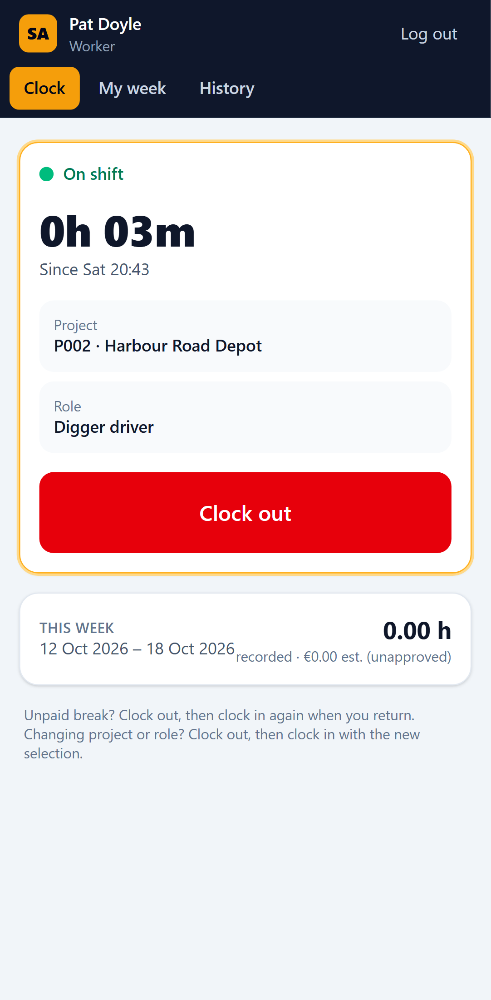

Week view: each entry with hours, rate and value, the totals, and *Submit* once the week has ended.

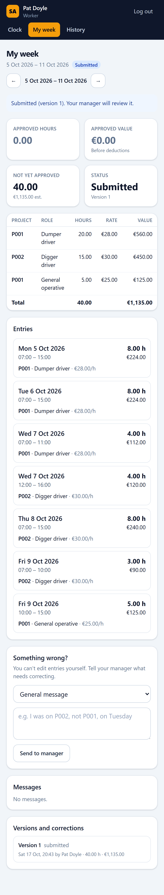

History: past weeks and their status.

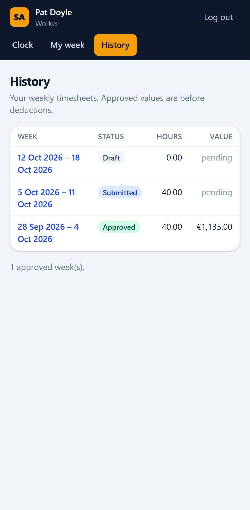

### Manager
Queue: submitted, overdue, returned and flagged timesheets for assigned workers.

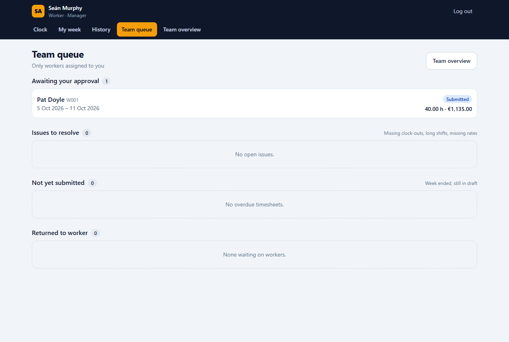

Review: entries, flags, the version, corrections with reasons, and the *Return*, *Approve* and *Reopen* actions.

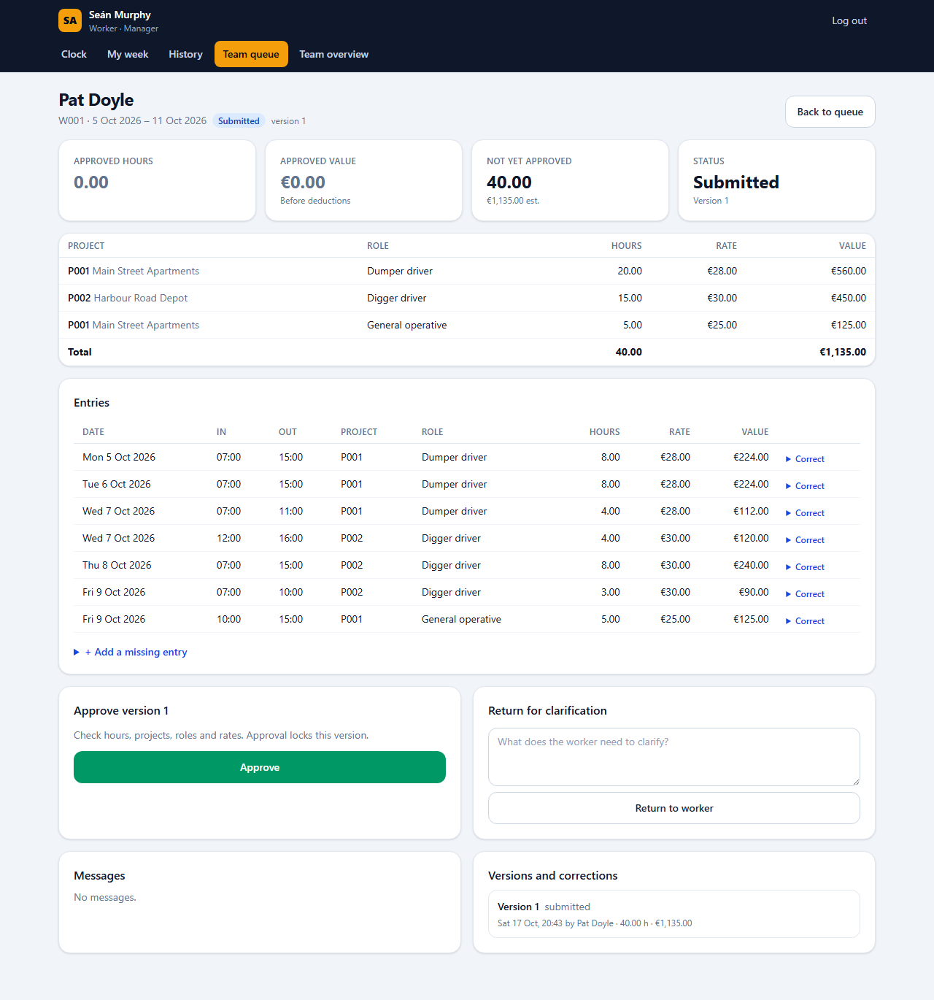

Team overview, filtered by week, worker, project and status.

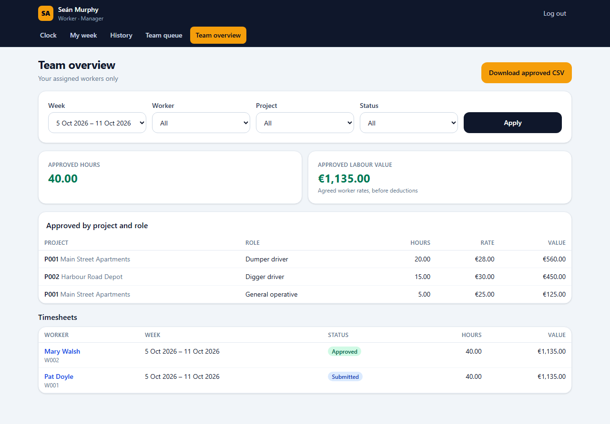

The same review screen on a phone.

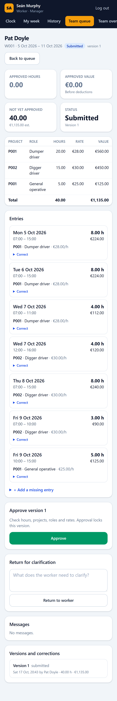

### Admin
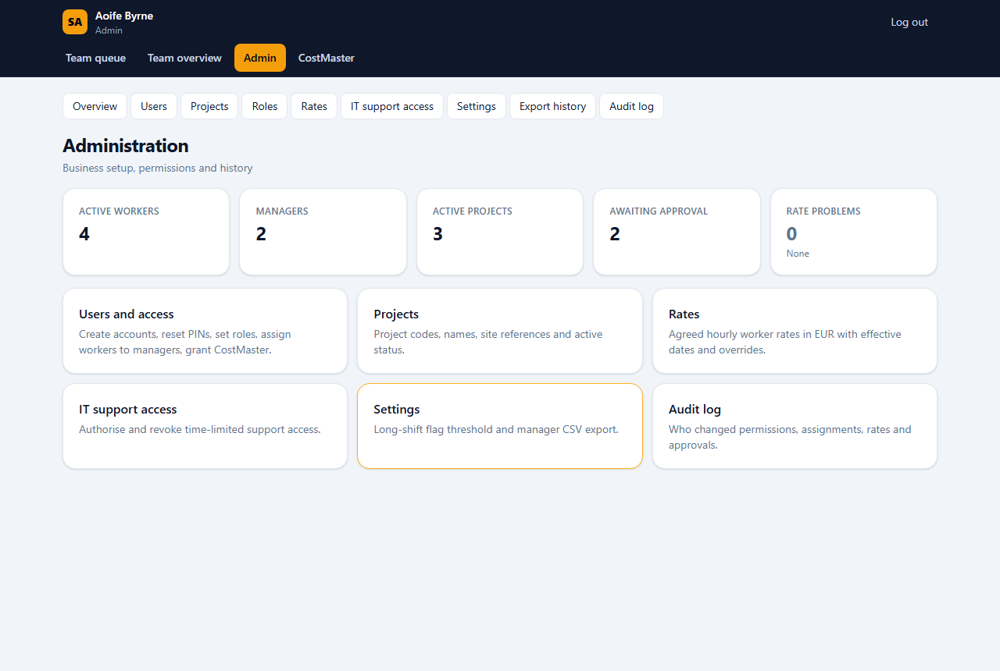
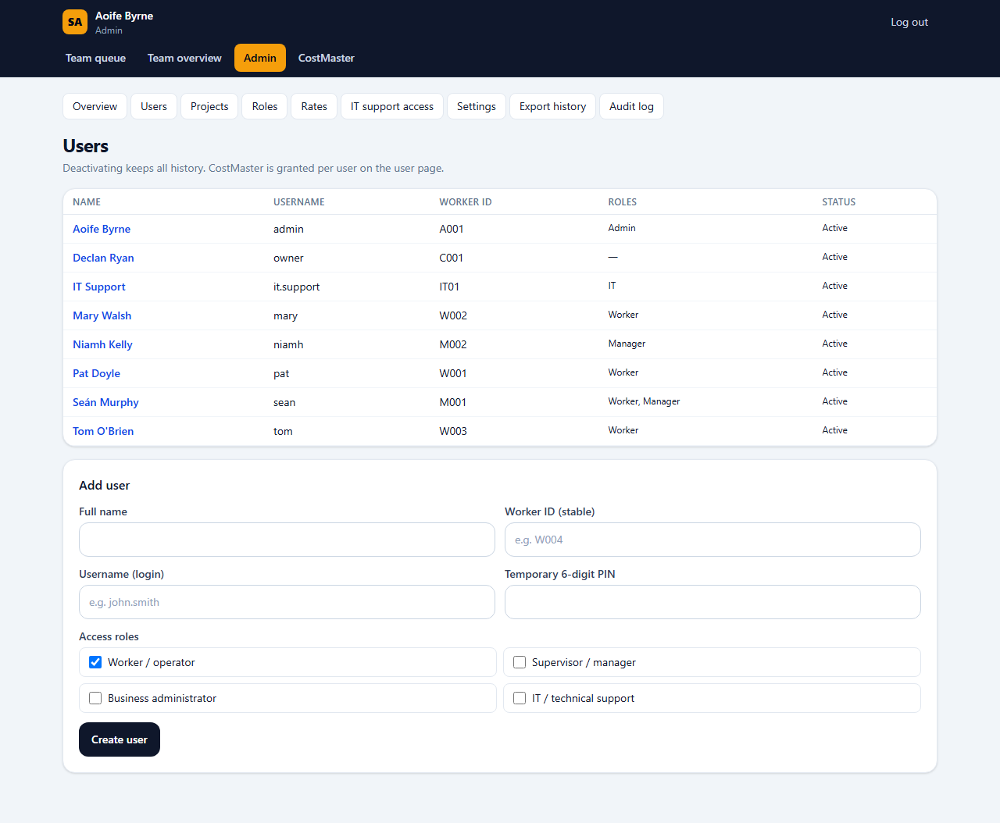
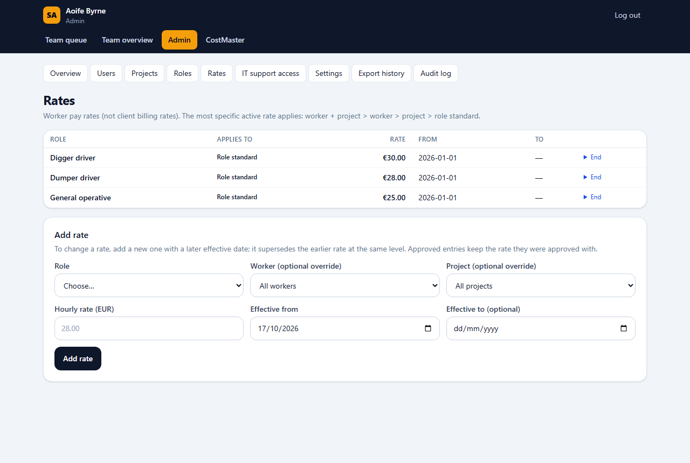
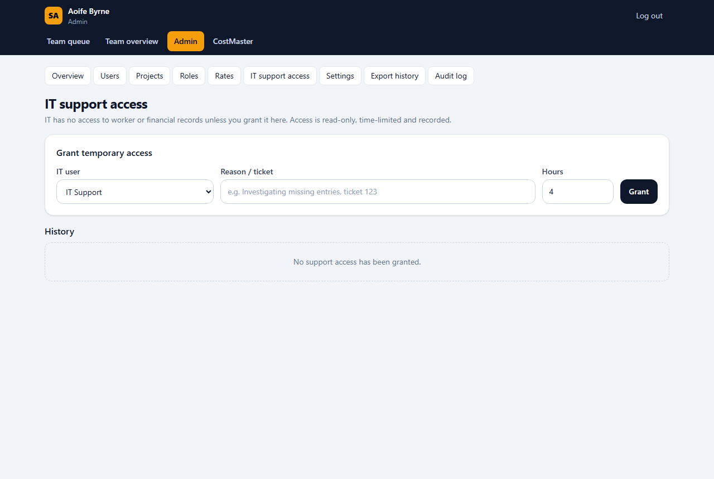
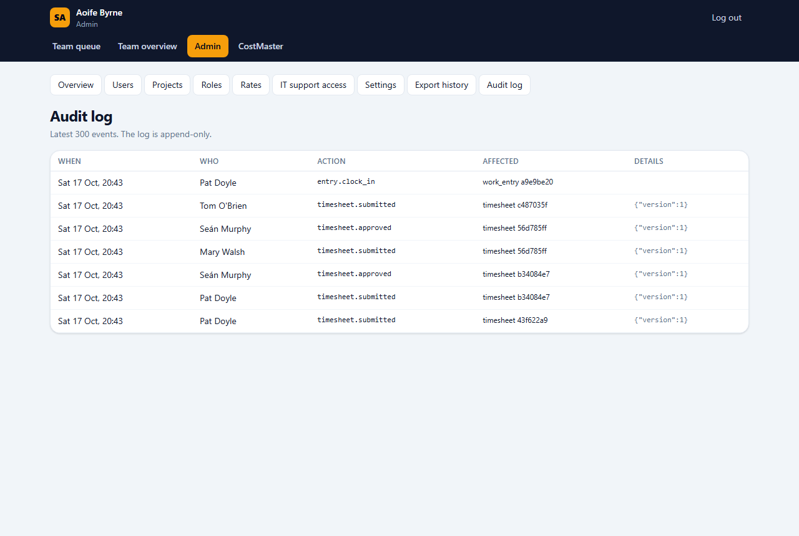

### CostMaster
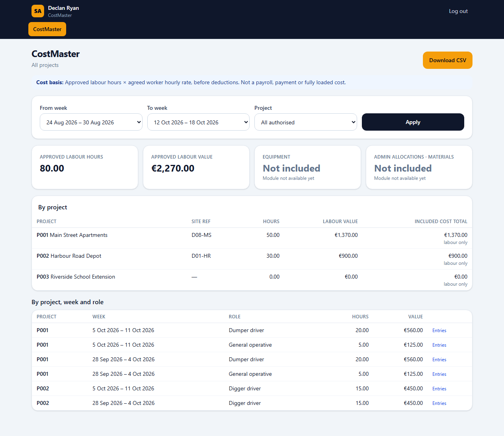

### IT
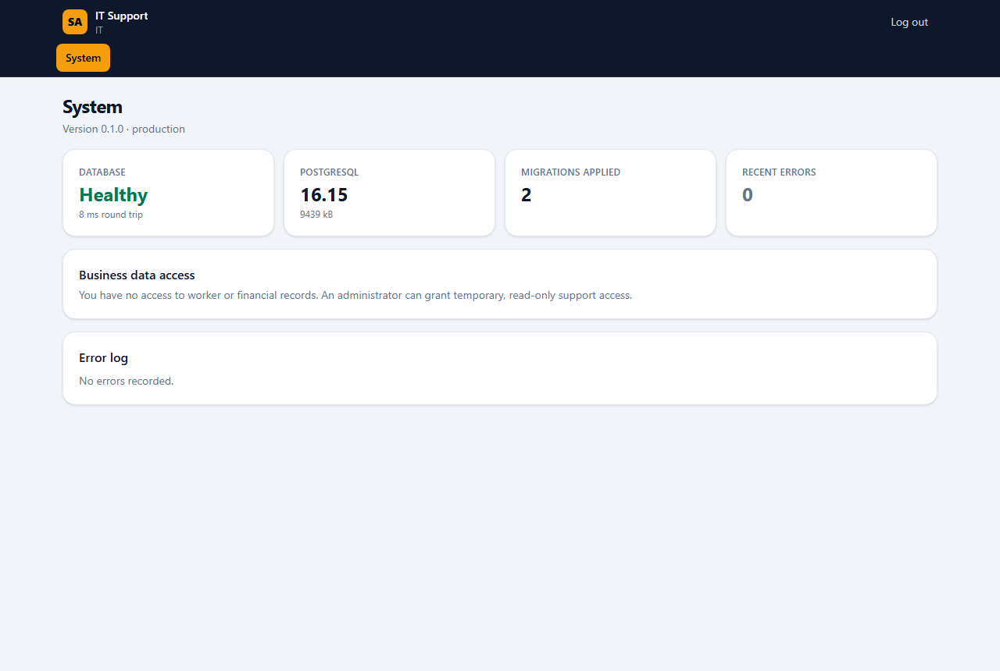

## 16. Running and testing

The setup commands are in the [README](../README.md). In short: `docker compose up -d`, `pnpm db:migrate`, `pnpm seed`, `pnpm dev`. The demo logins are at the top of `scripts/seed.ts`.

- `pnpm test`: Vitest. `tests/unit/time-money.test.ts` covers week splitting, DST and rounding. `tests/integration/workflow.test.ts` runs the acceptance scenarios against the `attendance_test` database: idempotent and concurrent clocking (T01/T06), the €1,135 example (T02), isolation (T03), corrections and return (T04), approval controls and rate changes (T05), the week split (T07), and IT/CostMaster limits (T08).
- `pnpm e2e`: Playwright business acceptance tests T01–T08 (`e2e/acceptance.spec.ts`) and responsive layout checks (`e2e/responsive.spec.ts`).
- `node e2e/screenshots.mjs [baseUrl]`: regenerates the screenshots above.
